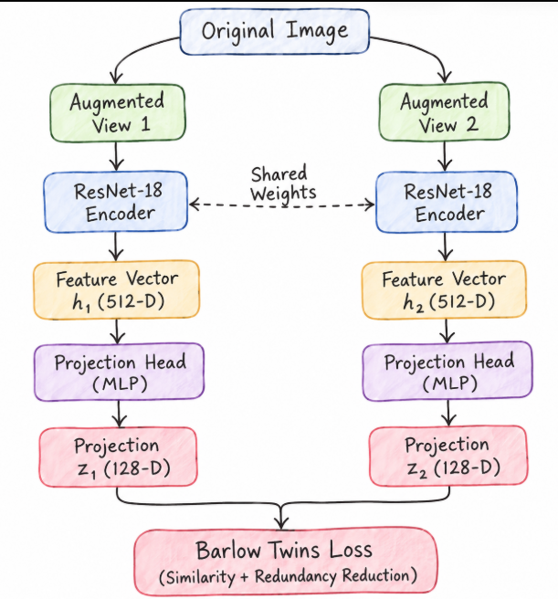
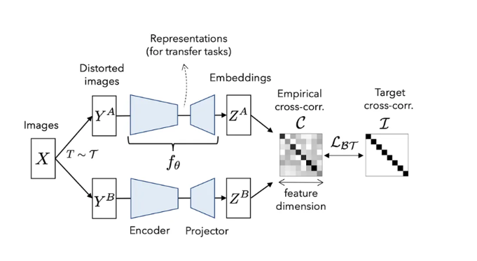
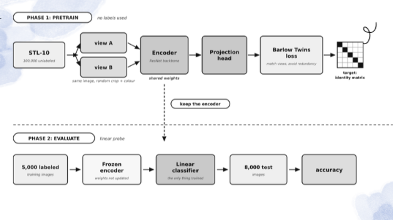
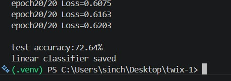
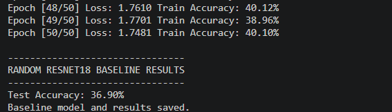
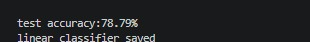
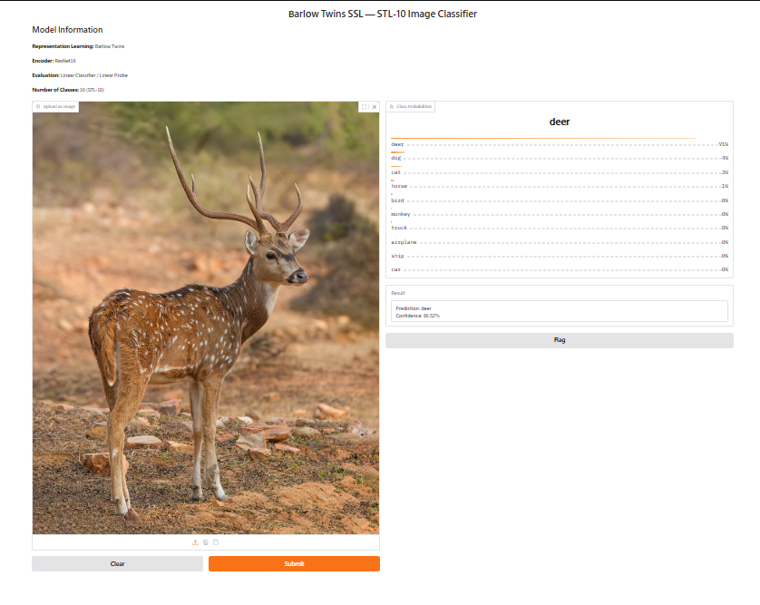

# TWIX: Learning Without Labels: Exploring Self-Supervised Learning with Barlow Twins

*Building an image representation learning pipeline using PyTorch,
ResNet-18 and the STL-10 dataset.*

## Mentees

-   [Sinchana.S] - (https://github.com/SinchanaS-11)
-   [Aaditya Prakash] -
-   [Navya Suresh]-(https://github.com/nav-yeah)

## Mentors

-   [Aditi Vignesh]-(https://github.com/irongirl101)
-   [Andey Hemanth]-(https://github.com/Andy34G7)


  [LINK TO REPOSITORY]-(https://github.com/homebrew-foss/twix) 


Machine learning models are traditionally trained using labelled
datasets, where every image is associated with a category or class. But
what happens when we have thousands of images and not enough labels?

This question led us to explore **Self-Supervised Learning (SSL)**, a
learning approach where models learn meaningful representations directly
from the data without requiring manually assigned labels during
pretraining.

For our project, we explored **Barlow Twins**, a self-supervised
learning framework that learns by comparing different augmented views of
the same image. Instead of teaching the model to identify whether an
image belongs to a particular class, we wanted it to understand the
underlying visual features that make an image meaningful.

Our implementation was built using PyTorch and the STL-10 dataset.

## Understanding Barlow Twins

The central idea behind Barlow Twins is surprisingly simple: take one
image, create two different versions of it, and train a neural network
to produce similar representations for both.

For example, an image might be randomly cropped, flipped, blurred or
have its colours adjusted. Although the resulting images look different,
they still represent the same underlying object.

Barlow Twins uses these two views to learn representations that remain
consistent despite such transformations.

The framework also aims to reduce redundancy between different
dimensions of the learned representations. It achieves this using a
cross-correlation matrix, encouraging its diagonal elements to approach
one and its off-diagonal elements to approach zero.

Unlike approaches that rely on negative image pairs, Barlow Twins uses
this redundancy-reduction objective to avoid representation collapse.


### References

-   [Barlow Twins paper (arXiv)](https://arxiv.org/pdf/2103.03230)
-   [Paper Explained: Barlow Twins --- Self-Supervised Learning via
    Redundancy
    Reduction](https://medium.com/@nazimbendib/paper-explained-barlow-twins-self-supervised-learning-via-redundancy-reduction-barlow-twins-92c90b49b21e)

## Building the Data Pipeline

Before implementing the model, we needed a data pipeline capable of
producing the inputs required by Barlow Twins.

We selected the STL-10 dataset, which contains RGB images of size 96 ×
96 across ten object categories.

An important part of the pipeline was implementing a custom dataset and
data loader.

Rather than returning a single image, our data loader generates two
independently augmented views of every input image.

Each training step therefore receives two tensors:

``` text
[B, 3, 96, 96]
```

Here:

-   **B** represents the batch size.
-   **3** represents the RGB colour channels.
-   **96 × 96** represents the image dimensions.

Both views have identical tensor dimensions because they are processed
symmetrically by the network.

One interesting part of this stage was understanding the importance of
augmentation strength. Weak augmentations can make the learning task too
easy, while excessively strong transformations can remove important
semantic information from the image.

Getting this balance right is an important part of building an effective
SSL pipeline.


## Designing the Encoder: ResNet-18

With the data pipeline ready, we moved on to the model architecture.

We selected **ResNet-18** as our encoder.

ResNet-18 is a convolutional neural network that uses residual
connections, also known as skip connections. These connections allow
information and gradients to flow through the network more effectively,
making deeper networks easier to train.

However, the original ResNet-18 architecture is designed for supervised
image classification and includes a final fully connected classification
layer.

Since our objective was representation learning rather than direct
classification, we removed this final classifier.

This allowed us to use ResNet-18 purely as a feature extractor.

The encoder produces a **512-dimensional feature vector** for each input
image. This vector represents the visual information extracted from the
image, including patterns such as edges, textures and shapes.

## The Projection Head: Transforming Features

The encoder alone is not the entire architecture.

After extracting the 512-dimensional feature vector, we pass it through
a projection head implemented as a **Multi-Layer Perceptron (MLP)**.

Unlike the encoder, which uses convolutional layers to process spatial
image information, the projection head uses fully connected layers to
transform the feature vectors.

Its purpose is to map the encoder's representations into a space where
the Barlow Twins loss can be calculated.

The two augmented views pass through the same encoder and projection
head, with shared weights.

This gives us two projected representations that are then used to
calculate the cross-correlation matrix.

## Putting the Training Pipeline Together

Once the architecture was ready, we integrated the data loader, encoder,
projection head and loss function into a single training pipeline.

The training process follows this sequence:

1.  Load a batch of unlabeled images.
2.  Generate two augmented views of every image.
3.  Pass both views through the shared ResNet-18 encoder.
4.  Obtain the 512-dimensional feature representations.
5.  Pass the features through the MLP projection head.
6.  Calculate the Barlow Twins cross-correlation matrix and loss.
7.  Perform backpropagation and update the model weights.

This process is repeated across batches and epochs.

An important distinction is that both the encoder and projection head
are trained during pretraining. Once pretraining is complete, the
projection head can be discarded, while the encoder is retained for
downstream tasks.


## Experimenting with Training Configurations

Getting the architecture working was only one part of the project. We
also needed to investigate how different training configurations
affected learning.

Our initial experiment used:

-   **Optimizer:** Adam
-   **Learning-rate strategy:** Constant learning rate
-   **Training duration:** 100 epochs

This initial configuration achieved **72.64% downstream classification
accuracy**.


After establishing this baseline, we decided to experiment with a more
refined optimization strategy.

We increased the training batch size to **128** and extended training
from **100 to 200 epochs**.

More importantly, we switched from Adam to **AdamW**.

AdamW decouples weight decay from the gradient-based parameter update.
Weight decay acts as a regularization technique that discourages
unnecessarily large weights and can help improve generalization.

We also introduced two learning-rate scheduling techniques:

### Learning-rate warm-up

Instead of starting training immediately with the full learning rate,
warm-up gradually increases it during the initial training steps. This
helps make the early optimization process more stable.

### Cosine annealing

After warm-up, cosine annealing gradually decreases the learning rate
following a cosine-shaped schedule. This allows larger updates earlier
in training and smaller, more precise adjustments later.

Together, these changes gave us a more carefully designed training
configuration.

## Evaluating the Results

Our final implementation achieved **78.79% accuracy** in downstream
classification evaluation.

This was an encouraging result because the encoder had learned its
representations without using class labels during pretraining.

To evaluate the effectiveness of Barlow Twins, a baseline experiment was conducted using a randomly initialized ResNet-18 encoder with a linear classifier. The baseline achieved 36.90% test accuracy, whereas the Barlow Twins model achieved 78.79%, demonstrating a substantial improvement in learned feature representations.
However, we also recognized that accuracy alone does not establish
whether self-supervised learning is superior to supervised learning. A
fair comparison would require a supervised baseline trained and
evaluated under comparable conditions.





The updated training configuration was intended to investigate whether
improved optimization and a longer training schedule could produce
better representations.






## What We Learned

This project helped us understand that training a neural network
involves much more than choosing an architecture and running a training
loop.

Some of the key things we learned were:

-   How self-supervised learning can extract useful representations
    without manually labelled data.
-   How to build a custom PyTorch data pipeline that generates paired
    augmented views.
-   How ResNet-18 works as a feature extraction backbone.
-   Why the classifier is removed during self-supervised pretraining.
-   How an MLP projection head transforms encoder representations.
-   How the Barlow Twins loss uses cross-correlation and redundancy
    reduction.
-   How optimizers, batch size, epochs and learning-rate schedules
    influence training.

Perhaps the most interesting takeaway was understanding that a neural
network does not necessarily need class labels to learn meaningful
visual patterns.

## Conclusion

What started as an exploration of self-supervised learning turned into a
complete image representation learning pipeline.

Using PyTorch, ResNet-18, STL-10 and Barlow Twins, we built a system
that learns from two augmented views of unlabeled images and produces
reusable visual representations.

Beyond the final **78.79% downstream accuracy**, the project gave us an
opportunity to experiment with training strategies, understand
optimization in practice and explore an alternative to traditional
supervised learning.

